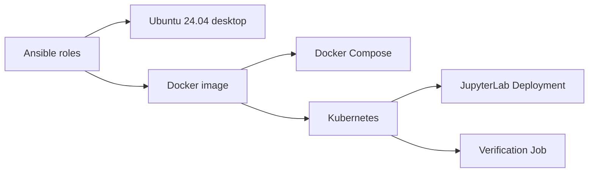

# Linux Workstation Setup

[](https://github.com/Niyi-Momoh/linux-workstation-setup/actions/workflows/ci.yml)

One Ansible codebase that builds the same robotics and machine learning environment three ways:
on an Ubuntu 24.04 desktop, as a hardened Docker image, and as a Kubernetes deployment.



## Verified results

| Environment | Check | Result |
|---|---|---|
| Fresh Ubuntu 24.04 container | First run completes | Pass |
| Fresh Ubuntu 24.04 container | Second run changes nothing | Pass: `changed=0` in 16 s |
| Fresh Ubuntu 24.04 container | C++ build, ML stack, JupyterLab and OpenSCAD render | 8 of 8 pass |
| Docker | Refuses a missing or short access token | Pass |
| Docker | Tools work with a read-only filesystem and no Linux capabilities | Pass |
| Docker | Runs as non-root and reports healthy | Pass |
| Kubernetes 1.37 | Accepted under the `restricted` Pod Security level | Pass |
| Kubernetes 1.37 | Verification Job passes inside the cluster | 8 of 8 pass |
| Kubernetes 1.37 | Refuses requests without the token and accepts those with it | Pass |
| Kubernetes 1.37 | Workspace survives pod replacement | Pass |
| Kubernetes 1.37 | Privileged pods are rejected | Pass |

The Kubernetes checks ran on a real single-node cluster with containerd and on a kind cluster in CI. CI also installs and checks ROS 2 and kubectl on a fresh system. The image is 983 MB
compressed and 4.15 GB unpacked, because it includes the C++ toolchain, OpenSCAD and the ML stack.

## What it installs

| Role | Contents |
|---|---|
| `base`, `shell` | Core command line tools, managed shell settings, tmux and Git defaults |
| `cpp` | GCC, Clang, CMake, Ninja, GDB, Valgrind, clang-format and clang-tidy |
| `python`, `ml` | Python tools, NumPy, SciPy, scikit-learn, pandas and JupyterLab |
| `cad` | OpenSCAD |
| `containers`, `kubernetes_tools` | Docker, Docker Compose and kubectl |
| `robotics` | ROS 2 Jazzy, ROS development tools and serial and CAN utilities |
| `desktop` | GNOME utilities and preferences |

## Use it

**Set up an Ubuntu 24.04 computer.** Read the roles first, as this installs software and changes settings.

```bash
./install.sh
./install.sh --skip-tags robotics,cad    # choose what to install
```

Your `.bashrc` is edited only inside a marked block, and earlier versions are backed up. Docker
group membership gives root-level access to the computer, so skip `containers` if you do not want that.

**Run it with Docker.**

```bash
export JUPYTER_TOKEN="$(openssl rand -hex 24)"
docker compose up --build
```

Open <http://127.0.0.1:8888> and sign in with the token. The port is only available on your computer.

**Deploy it to Kubernetes** using [kind](https://kind.sigs.k8s.io/).

```bash
scripts/deploy-kind.sh
scripts/k8s-smoke.sh
kubectl -n workstation port-forward service/workstation 8888:8888
```

## Kubernetes design

- **Pod security:** the namespace enforces the `restricted` standard, and containers run as non-root with a read-only filesystem, no capabilities and a default seccomp profile.
- **Secrets:** the access token is generated at deploy time and is never stored in Git.
- **Reliability:** startup, readiness and liveness probes use the server's health endpoint, with CPU and memory limits set.
- **Storage:** a persistent volume holds the workspace, using a `Recreate` strategy because the volume attaches to one pod at a time.
- **Network:** the service is internal only, and a NetworkPolicy limits incoming traffic to the namespace.

## Testing

Run these inside a fresh container or against a local cluster. CI runs the same scripts.

```bash
docker run --rm -v "$PWD:/src:ro" ubuntu:24.04 /src/scripts/test-clean-system.sh -e install_ros=false -e install_kubernetes_tools=false
scripts/test-image.sh
```

## Limitations

- The desktop role was tested in a container with a stand-in for GNOME, not on a physical desktop. The Docker service step only runs under systemd.
- The single-node test cluster did not enforce NetworkPolicy, so the policy was accepted but its blocking behaviour was not tested.
- The token protects JupyterLab, but anyone with the token can run code in it. Do not expose it publicly without HTTPS and stronger login controls.
- Only Ubuntu 24.04 is supported.

Licensed under MIT.
